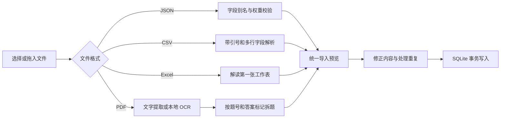

# 功能实现与代码结构

本文对应 v0.2.0，描述仓库中已经实现的行为。

## 结构

```text
Sources/
├── CSQLite/                  # 系统 SQLite C API 桥接
├── OneQuestionCore/
│   ├── Models.swift          # 题目、评分要点、作答与导入模型
│   ├── Database.swift        # SQLite 存储与事务
│   ├── QuestionImporter.swift# JSON / CSV / Excel 导入
│   ├── PDFQuestionImporter.swift # PDF 提取、OCR 与拆题
│   └── AIClient.swift        # AI 请求与返回结果校验
└── OneQuestionMac/
    ├── Launcher.swift        # GUI / 安全配置 / 接口自检入口
    ├── OneQuestionApp.swift  # 原生窗口、菜单栏与菜单命令
    ├── AppStore.swift        # 练习状态、持久化与异步任务
    ├── PracticeView.swift    # 答题卡与评价展示
    ├── LibraryView.swift     # 题库、导入预览、编辑与历史
    ├── SettingsView.swift    # 模型配置与数据目录入口
    └── Keychain.swift        # macOS 钥匙串读写
```

## 单题练习

`AppStore` 在主线程维护当前题目、回答草稿、提交状态、筛选条件和异步任务。`PracticeView` 通过 SwiftUI 状态绑定呈现一道题。

1. 按题库、待复习条件筛选可练习的题目。
2. 文字修改后约 350 ms 保存草稿；应用失去焦点或退出时补充保存。
3. 提交前验证非空及长度，先写入 `Attempt`，再按设置发起 AI 评价。
4. 未启用 AI 时展示参考答案和自评操作。
5. 改写重答产生新的记录，保留上一版回答；顺序或随机切换到下一题。

窗口置顶由 AppKit 的窗口层级控制；菜单栏图标负责重新显示答题窗口。当前快捷键作用于应用，尚未注册系统级全局热键。

## 多格式导入



### JSON / CSV / Excel

- **JSON**：使用 `JSONSerialization` 接受题目数组或包含 `questions` 的对象，支持中英文字段别名、评分要点 ID 与独立权重。
- **CSV**：状态机处理 BOM、逗号、转义双引号、CRLF 与引号内换行，拒绝未闭合引号。
- **Excel**：通过系统 `/usr/bin/unzip` 读取 OOXML，再用 `XMLParser` 解析 workbook 关系、共享字符串、inline string 和首张工作表。无需 Excel 或额外解压库，不执行公式或宏。
- 文件最大 20 MB，每次最多 20000 题；Excel 限制 100 列。评分要点最多 50 条，权重 1–100。
- 题目必填，参考答案可稍后补充；缺少评分依据时禁止自动评价。
- 按题目 ID 或规范化后的题目名称识别已有题目，提供跳过或更新策略。更新保留原 ID 和历史作答快照。
- 全部题目通过一次 SQLite 事务写入，失败时回滚。

### PDF 与扫描件

`PDFQuestionImporter` 在后台逐页处理，最多 200 页、200 万字提取内容：

1. PDFKit 读取可复制的文字；文字过少的页面尝试渲染为图像。
2. Vision 使用中英文识别与自动语言检测，CPU 上本地完成 OCR。
3. 为每页添加内部页码标记，再按数字题号、`题目：`、`Q:` 等标记拆题。
4. 区分题干、答案和评分要点，合并跨页内容，保留代码块和数字答案。
5. 对明确重复的资料页眉做有限过滤；不把无题目分隔的段落编造成试题。
6. 预览支持逐题编辑，以及编辑提取文字后重新拆题；显示缺失答案和未完整提取的页码。

来源文件名及页码保存在 `Question.source`，导出 JSON 后仍保留。PDF 文件不上传到评分服务。解析按页报告进度，取消会中止后续处理且不修改已有题库。

这是一套规则拆题流程，不是通用文档理解模型。复杂分栏、数学公式、图表、手写与低清扫描需要人工校对；加密或限制内容复制的文件会返回明确错误。

## AI 分项评价

`AIClient` 使用临时 `URLSession` 调用用户配置的 Chat Completions 兼容服务。请求仅包含当前题目、参考答案、评分要点和本次回答。

- URL 校验要求远程 HTTPS；本地模型允许 loopback HTTP。
- JSON 模式可以在设置中关闭，以兼容不同服务商。
- 每条要点返回整数得分、原文引用、解释；另外提供总体反馈、具体纠正和改进回答。
- 客户端验证要点集合完整、ID 无重复、分数在权重范围内，且引用确实存在于原始回答中。
- 有分数的条目必须提供原文依据，总分由客户端求和。
- 请求不跟随重定向；错误信息会遮盖已知 API 密钥。
- 网络失败或结果校验失败时保留作答记录，允许重试与自评。

没有单独配置评分要点时，会建立一个 10 分的参考答案综合评价项。AI 的事实判断仍需人工复核，格式及引用校验不等同于验证模型判断一定正确。

## 持久化与复习

SQLite 使用三张表，记录通过 `Codable` 序列化为 JSON：

| 表 | 内容 |
|---|---|
| `questions` | 当前题目、参考答案、要点、标签与来源 |
| `attempts` | 原始回答、当时题目快照、评价、自评与时间 |
| `preferences` | AI 的非敏感设置、当前题目 ID 与草稿 |

数据库开启 WAL，使用参数绑定写入。题目修改或删除不会修改作答快照；删除题目也不删除已有历史记录。

“只练待复习”取每道题最近一次作答：自评优先；没有自评时，AI 得分低于 80% 或尚未评价的题进入待复习集合。当前没有按日期间隔执行的复习调度器。

## 凭据与本地配置

API 密钥使用 Keychain Services 存入 macOS 钥匙串，非敏感设置写入 SQLite。源码、题库 JSON 和导出文件不包含运行时密钥。

`Launcher` 提供两个辅助入口：

- `--configure-ai`：从标准输入读取配置，写入后通过钥匙串读回校验。
- `--test-ai`：使用一条内置公开示例调用已配置服务，输出脱敏的自检摘要，不写入练习历史。

`scripts/configure-runtime.py` 通过隐藏输入收集密钥，经标准输入传给应用，不写入文件或命令行参数。配置变更通过本机通知和应用激活事件重新载入。

## 验证范围

当前有 16 项 Swift Testing 测试，覆盖表格导入、字段校验、SQLite 快照、AI 格式与引用校验、PDF 跨页提取、中英文扫描 OCR、数字答案、代码块和模糊资料处理。

本地 OCR 测试依赖 macOS Vision 服务，受限沙箱可能阻止服务访问。真实 AI 接口另行自检，需要维护者自行提供有效账户及接口凭据。测试中不包含真实密钥或个人题库。
